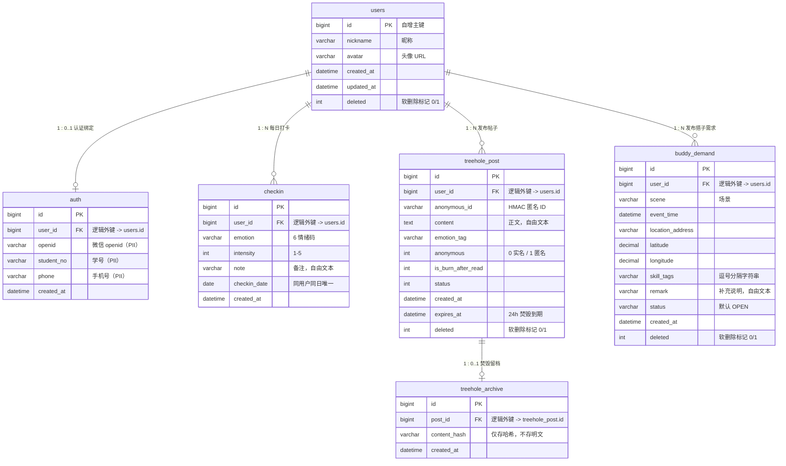

# OUC同频 V0.1 ER 图与字段字典

> 版本：v0.1 · 2026-11-15 补做 · 对应 develop `40feb0b`
> **⚠️ 2026-11-15 晚追记（#82 合入）**：本文正文是 develop `40feb0b` 时点的快照。PR #82 已 squash 合入 develop `0b6649a`，`01-schema.sql` 现为 **7 张实装表**（新增 `treehole_identity`），`treehole_post` 移除 `user_id`、`anonymous_id` 改为 `NOT NULL`，并**首次建立 `FOREIGN KEY`**（`fk_treehole_identity_post`）。因此正文中「6 张表」「数据库未建 FOREIGN KEY / 无外键」是**合入前的时点记录**，按双轨纪律保留不回改；**最新结构一律以 `01-schema.sql` 为准**。既有共享库须由 M5 备份停写后执行 `infra/db/migrations/20261115-treehole-identity-separation.sql`。相关代码改动见 PR #82 的 squash 提交 `0b6649a`（已合入 develop）。
> **⚠️ 2026-11-16 追记（#85 合入）**：PR #85 已 squash 合入 develop `31114dc`。表数量仍是 **7 张**，`auth.openid` 由普通索引改为 `UNIQUE KEY uk_auth_openid`；另新增 `infra/db/init/02-runtime-permissions.sh`（应用账号仅业务 DML、只读公开投影视图与角色）与 `infra/db/migrations/20261115-auth-identity-unique.sql`（重复身份拒绝迁移、不删数据）。本文正文仍是 `40feb0b` 时点的快照，按双轨纪律保留；最新结构以 `01-schema.sql` 为准。隔离栈上的 JWT / 越权 / PII 20/20 已验证，但真实微信平台 / 业务验收未完成，共享库未升级。
> **唯一事实源**：`infra/db/init/01-schema.sql`（另见 `infra/db/migrations/20261109-checkin-unique.sql`）。本文是建表 SQL 的可读视图，字段有出入时一律以 SQL 为准。
> **范围声明**：本文只描述**当前实装的 6 张表**。`docs/故事落地与开发指南.md` §0 中「18 张核心表 ER 图 + 字段字典」是 W1 的设计目标，**从未产出、也未实装**；本文不把它写成已完成。
> **补做留痕**：原主责 M5，本文件由 **M1 于 11/15 代做**；W4 评审 / 回顾记录里不得写「M5 完成 ER 图」。
> **双轨纪律**：11/15 已定稿的 `docs/team/blog/Alpha测试报告.md`、已发布的第六 / 第七周博客里「ER 图未定稿」是当时时点的记录，本文**不回改**它们；本文件是 11/15 之后新增的交付物。
> 配套：`docs/api/接口契约与实装状态-v0.1.md`（接口 ↔ 数据表映射）。

---

## 一、ER 图（Mermaid）

> ⚠️ **图中的 FK 是逻辑关系，不是数据库约束**：`01-schema.sql` 里**没有任何 `FOREIGN KEY` / 级联删除**，只有普通索引与一个唯一索引；引用完整性靠应用层保证，不能据此声称「数据库已强制外键」。
> ⚠️ 当前所有写入都使用 demo `userId=1L`（无 JWT），因此 `user_id` 上的 1 : N 关系**尚未在多用户下验证**。

---

## 二、字段字典（逐表，照抄建表 SQL）

### 2.1 `users` — 用户表

> 表名用 `users` 避开 MySQL 保留字 `user`。

| 字段 | 类型 | 可空 | 默认 | 键 / 索引 | 说明 |
|---|---|---|---|---|---|
| `id` | `BIGINT AUTO_INCREMENT` | NOT NULL | — | `PRIMARY KEY` | 内部用户 ID |
| `nickname` | `VARCHAR(64)` | NULL | NULL | — | 昵称 |
| `avatar` | `VARCHAR(512)` | NULL | NULL | — | 头像 URL |
| `created_at` | `DATETIME` | NULL | NULL | — | 创建时间 |
| `updated_at` | `DATETIME` | NULL | NULL | — | 更新时间 |
| `deleted` | `INT` | NOT NULL | `0` | — | 软删除标记 |

### 2.2 `auth` — 认证 / 绑定表

| 字段 | 类型 | 可空 | 默认 | 键 / 索引 | 说明 |
|---|---|---|---|---|---|
| `id` | `BIGINT AUTO_INCREMENT` | NOT NULL | — | `PRIMARY KEY` | |
| `user_id` | `BIGINT` | NOT NULL | — | `idx_auth_user_id` | 逻辑外键 → `users.id` |
| `openid` | `VARCHAR(64)` | NULL | NULL | `idx_auth_openid` | 微信 openid（PII） |
| `student_no` | `VARCHAR(32)` | NULL | NULL | — | 学号（PII） |
| `phone` | `VARCHAR(20)` | NULL | NULL | — | 手机号（PII） |
| `created_at` | `DATETIME` | NULL | NULL | — | |

> 注意：`openid` / `student_no` 只建了**普通索引，没有唯一约束**；契约里「重复绑定校验」依赖 `POST /api/auth/student-verify`，而该接口实测 404（见配套契约文档），**不能写成已保证唯一**。

### 2.3 `checkin` — 每日情绪打卡表

| 字段 | 类型 | 可空 | 默认 | 键 / 索引 | 说明 |
|---|---|---|---|---|---|
| `id` | `BIGINT AUTO_INCREMENT` | NOT NULL | — | `PRIMARY KEY` | |
| `user_id` | `BIGINT` | NOT NULL | — | `idx_checkin_user`、`uk_checkin_user_date` | 逻辑外键 → `users.id` |
| `emotion` | `VARCHAR(16)` | NULL | NULL | — | 6 情绪码（见 `docs/requirements/情绪词库与强度量表-v1.md`） |
| `intensity` | `INT` | NULL | NULL | — | 1–5 强度 |
| `note` | `VARCHAR(100)` | NULL | NULL | — | 备注，自由文本 |
| `checkin_date` | `DATE` | NULL | NULL | `uk_checkin_user_date` | 打卡日期 |
| `created_at` | `DATETIME` | NULL | NULL | — | |

> `uk_checkin_user_date (user_id, checkin_date)` 保证**同用户同日幂等**；旧数据卷由 `infra/db/migrations/20261109-checkin-unique.sql` 补加（先 `SELECT` 查重复、再由数据所有者决定如何处理，**脚本不自动删历史行**）。

### 2.4 `treehole_post` — 树洞帖子表

| 字段 | 类型 | 可空 | 默认 | 键 / 索引 | 说明 |
|---|---|---|---|---|---|
| `id` | `BIGINT AUTO_INCREMENT` | NOT NULL | — | `PRIMARY KEY` | |
| `user_id` | `BIGINT` | NOT NULL | — | `idx_post_user` | 逻辑外键 → `users.id` |
| `anonymous_id` | `VARCHAR(64)` | NULL | NULL | — | HMAC 生成的匿名 ID |
| `content` | `TEXT` | NULL | NULL | — | 正文，自由文本；发布前送内容审核 |
| `emotion_tag` | `VARCHAR(16)` | NULL | NULL | `idx_post_emotion` | 情绪标签 |
| `anonymous` | `INT` | NOT NULL | `0` | — | 匿名 / 实名切换 |
| `is_burn_after_read` | `INT` | NOT NULL | `0` | — | 焚毁标记 |
| `status` | `INT` | NOT NULL | `0` | `idx_post_status_expire` | 状态 |
| `created_at` | `DATETIME` | NULL | NULL | — | |
| `expires_at` | `DATETIME` | NULL | NULL | `idx_post_status_expire` | 24h 到期时间 |
| `deleted` | `INT` | NOT NULL | `0` | — | 软删除标记 |

### 2.5 `treehole_archive` — 树洞焚毁留档表

| 字段 | 类型 | 可空 | 默认 | 键 / 索引 | 说明 |
|---|---|---|---|---|---|
| `id` | `BIGINT AUTO_INCREMENT` | NOT NULL | — | `PRIMARY KEY` | |
| `post_id` | `BIGINT` | NOT NULL | — | `idx_archive_post` | 逻辑外键 → `treehole_post.id` |
| `content_hash` | `VARCHAR(64)` | NULL | NULL | — | **仅存内容哈希，不存明文** |
| `created_at` | `DATETIME` | NULL | NULL | — | |

### 2.6 `buddy_demand` — 搭子需求表（#78 新增）

> SQL 注释原文：只存发布内容；列表 / 筛选 / 排序属 V1.0 `#12`，**暂无 GET 契约**。

| 字段 | 类型 | 可空 | 默认 | 键 / 索引 | 说明 |
|---|---|---|---|---|---|
| `id` | `BIGINT AUTO_INCREMENT` | NOT NULL | — | `PRIMARY KEY` | 返回给前端时转字符串 |
| `user_id` | `BIGINT` | NOT NULL | — | `idx_need_user` | 逻辑外键 → `users.id` |
| `scene` | `VARCHAR(64)` | NULL | NULL | — | 场景（送审字段之一） |
| `event_time` | `DATETIME` | NULL | NULL | — | 约定时间 |
| `location_address` | `VARCHAR(255)` | NULL | NULL | — | 地点文本 |
| `latitude` | `DECIMAL(10,6)` | NULL | NULL | — | 纬度，供距离排序 |
| `longitude` | `DECIMAL(10,6)` | NULL | NULL | — | 经度，供距离排序 |
| `skill_tags` | `VARCHAR(512)` | NULL | NULL | — | 技能标签（契约限制 ≤5） |
| `remark` | `VARCHAR(200)` | NULL | NULL | — | 补充说明（送审字段之一） |
| `status` | `VARCHAR(16)` | NOT NULL | `'OPEN'` | `idx_need_status_created` | 状态 |
| `created_at` | `DATETIME` | NULL | NULL | — | `idx_need_status_created` |
| `deleted` | `INT` | NOT NULL | `0` | — | 软删除标记 |

---

## 三、约束与索引一览

| 对象 | 表 | 类型 | 字段 | 来源 / 备注 |
|---|---|---|---|---|
| `PRIMARY` | 6 张表 | 主键 | `id` | `01-schema.sql` |
| `uk_checkin_user_date` | `checkin` | **UNIQUE** | `(user_id, checkin_date)` | `01-schema.sql`；旧卷由 `migrations/20261109-checkin-unique.sql` 补加 |
| `idx_auth_user_id` / `idx_auth_openid` | `auth` | INDEX | `user_id` / `openid` | `01-schema.sql` |
| `idx_checkin_user` | `checkin` | INDEX | `user_id` | `01-schema.sql` |
| `idx_post_user` / `idx_post_emotion` / `idx_post_status_expire` | `treehole_post` | INDEX | `user_id` / `emotion_tag` / `(status, expires_at)` | `01-schema.sql` |
| `idx_archive_post` | `treehole_archive` | INDEX | `post_id` | `01-schema.sql` |
| `idx_need_user` / `idx_need_status_created` | `buddy_demand` | INDEX | `user_id` / `(status, created_at)` | `01-schema.sql` |

- 全部表 `ENGINE=InnoDB`、`CHARSET=utf8mb4`、`COLLATE=utf8mb4_unicode_ci`（支持 emoji）。
- `CREATE TABLE IF NOT EXISTS`，脚本幂等；但 MySQL 官方镜像**只在数据目录为空的首次初始化**时执行，已有卷需按脚注处理。
- **无外键、无级联、无触发器**；`deleted` 是应用层软删除标记，不是数据库级约束。

---

## 四、隐私与状态口径（不虚报）

- `auth.openid` / `student_no` / `phone` 是 PII；日志侧由 `RedactingCompositeConverter` 整行脱敏，匿名 ID 用 HMAC(密钥 + 用途 + 内部 ID) 生成，不用学号直接当主键。
- `treehole_archive` 只留 `content_hash`，不存正文；`treehole_post.anonymous_id` 在匿名态下不返回可反推身份的字段。
- `checkin.note`、`treehole_post.content`、`buddy_demand.remark` 是自由文本，发布前经 `/api/moderation/check` 前置过滤（#78 把 `scene + remark` 一并送审，审核不可达统一 503 且不落库）。
- **当前身份仍是 demo `userId=1L`，JWT 未接**；`user_id` 上的关联、幂等、多用户隔离都只在这个演示身份下验证过。
- 24h 焚毁：表结构已具备 `expires_at` / `deleted` / 留档表，但**到期端到端与列表 / 详情不可见仍属测试报告里的 BLOCKED**，不因画了图就算验收。

---

## 五、与 W1 设计草案的差异 / 未完成项

| 项 | W1 设计口径 | 当前实装 | 状态 |
|---|---|---|---|
| 表数量 | 18 张核心表 ER 图 + 字段字典 | 实装 6 张；本文补图 | **部分**，18 张目标未产出 |
| `user_tag` 关联表 | `PUT /api/user/profile` 写入兴趣 / 技能标签 | 无此表 | **未实装**（接口实测 404） |
| 学号认证 | `AuthProvider` 半自动审核 + 重复绑定校验 | `auth` 表留了字段，`student-verify` 404 | **未实装**，无唯一约束 |
| JWT / 多用户隔离 | `POST /api/auth/login` 返回 token | demo `userId=1L`，无拦截器 | **未实装** |
| 管理端数据表 / 接口 | 审核、看板、用户管理 | 无表、无 `/api/admin/*` 契约 | **未实装**（`admin-web` 仍是写死 mock） |
| 树洞详情 / 抱抱数 | 契约 `TreeholePost.hugCount`、24h 到期 | 无详情 path，`hugCount` 未在表结构落地 | **未实装 / 未验收** |
| 广场列表 | 设计含筛选 / 距离排序 | `buddy_demand` 只存发布内容，无 GET 契约 | **留给 V1.0 #12**，广场仍是标注「示例需求 · 演示数据」的假卡片 |

> #25（正式词库）、#26（真实业务 PII 验收）仍为 OPEN；本文件不改变 V0.1 里程碑 **9 关 / 2 开** 与测试报告的 55/25、63/17 两层口径。

---

## 六、维护约定

1. 改表先改 `infra/db/init/01-schema.sql`，已有数据卷另写 `infra/db/migrations/` 迁移（先查重复、不自动删数据），**再**更新本文。
2. 字段名、类型、默认值以 SQL 为准；本文只做可读化，不反向定义 schema。
3. 新增接口时同步 `packages/contract/openapi.yaml` 与 `docs/api/接口契约与实装状态-v0.1.md`，保持「契约 ↔ 表」映射不断链。
4. 本文为 11/15 之后补做，**不回改**已定稿的测试报告、已发布的第六 / 第七周博客与 W45 草稿。
