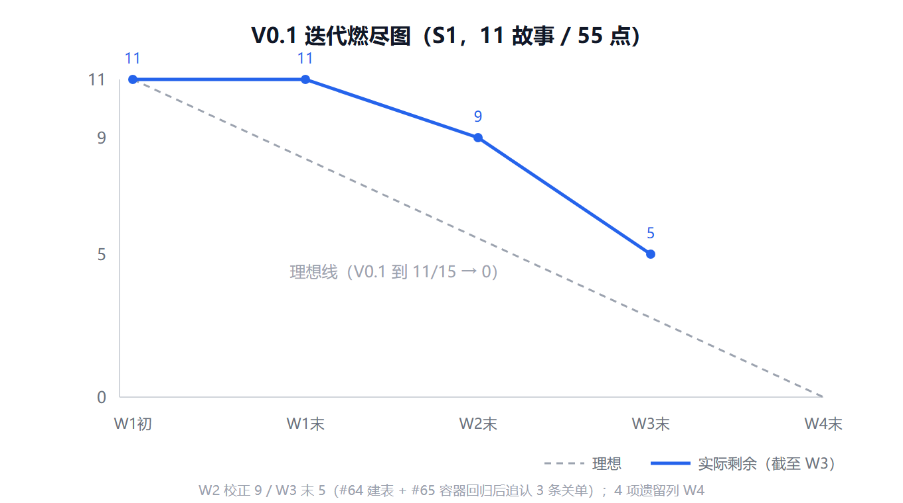

# 第七周 Scrum Meeting 会议记录（W3 / S1 第三周）

> 周期：11/03 – 11/08（Alpha 冲刺第三周 / W3；课程规范要求博客 2 于 11/08 前发布）
> 迭代：Alpha v0.1 / S1（11 个故事，55 故事点，到期 11/15，W1–W4）
> 形式：线上异步协作 + 周例会，进度以 GitHub Issue / Project 看板沉淀
> 仓库：https://github.com/tao452/ouc-tongpin
> 发布：M1 汇总发布；本文件为**仓库事实源**，公开发布需另转 CSDN 版（脱敏 M1–M6、拆宽表、图片改图床），做法参见同目录 `Scrum-Meeting-第六周-CSDN发布版.md`

<!-- ============================================================
     ⚠️ M1 填写指南（定稿后删除本段）
     ============================================================

【最紧急：今晚 11/07 就得发】
- 今天是 **2026-11-07（周六）晚**。课程规范：W3 = 11/02–11/06，**博客 2 于 11/08 前发布**；
  发布前自查明确写「发布日期在截止日之前，不是当天 23:59」→ **11/08 当天发即算踩线，最稳是今晚 11/07 发出**。
- 本仓库燃尽图口径：V0.1 W1–W4，W3 末数据点标 11/09、W4 末 11/15 到期。
  若今晚提前发布，燃尽图填「截至 11/07 实测值」并在图注注明，不要编 11/09 的数。
- 今晚顺序：① 补开周例会（拿 2 张照片 + 6 人口径）→ ② 定稿本文件 → ③ 转 CSDN 发布版 → ④ 发布 → ⑤ 提交入库 + 回填目录链接。

【必含四块（课程硬性要求）】
1. 每个人的工作：6 人全覆盖，三段式「完成 / 未完成及原因 / 阻碍」，禁止「参与了讨论」这类空话，禁止全绿。
2. 燃尽图：横轴日期、纵轴剩余故事点、理想线 + 实际线，数据要能说出来源。
3. 例会照片：**至少 2 张**（W2 只交了 1 张，这次补上），能看出人数 / 场景 / 日期，轮值拍照，命名 `YYYY-MM-DD-standup-*.jpg` 入 `docs/team/photos/`。
4. 代码及文档签入记录：每条能对上 Issue 编号，含提交数 / 变更行数 / 文档产出，能点开验证。

【素材采集命令】（在仓库根目录跑，日期按需改）
  git log --since="2026-11-03" --until="2026-11-09" --pretty=format:"%ad %an %s" --date=short
  git log --since="2026-11-03" --until="2026-11-09" --pretty=format:"%an" --numstat \
    | awk 'NF==1{who=$0} NF==3{add[who]+=$1; del[who]+=$2; cnt[who]++} \
      END{for(w in cnt) printf "%s\t%d\t+%d/-%d\n", w, cnt[w], add[w], del[w]}'
  gh pr list --state all --limit 30 --json number,title,state,mergedAt,author
  gh issue list --label S1 --state all --json number,title,state,closedAt
- 每人周五 12:00 前在自己 Issue 下写「本周小结」评论，M1 直接搬，别另开文档（否则两套说法对不上）。
- 没有 Issue 号的提交，如实写「该提交未关联 Issue，已在 #__ 补录说明」，别编。
- 定稿后由 M6 核对 Issue 链接有效性。

【W3 真实家底（11/07 19:20 实测，全部可在 GitHub 核验）】
- **W3 合入 PR 仅 1 条**：M6 的 #54 `[W1/M6] 补齐两端质量门禁与评审记录`（11/04 合入 develop）。该 PR 补的是 W1 交付物，但合入日在 W3，按签入日计入本篇。
- **在飞 PR 0 个**；V0.1 九条故事仍 open（#2/#4/#6/#8/#11/#25/#26/#33/#34），其中 8 条 Issue 停在 10-26、#33 停在 11-01 —— 这是本篇「未完成 / 阻碍 / 风险」必须如实写的核心事实，**别写成全绿**。
- **M1 本周至今 0 条 PR**：第六周 CSDN 发布版、本篇 W3 骨架、目录回填 3 个文件仍在工作区未提交。今晚提交入库即形成 M1 的文档类签入，§二 才有东西可写。
- **W2 博客已于 11/06 12:57 发布 CSDN**（https://blog.csdn.net/2501_90092470/article/details/170191783），属 M1 本周产出，可写进 §一 M1 行。
- 例会记录尚无（`standup/` 只有模板），照片只有第六周 1 张 → 今晚开会时补 **2 张**。
- ⚠️ **燃尽图口径差**：W2 博客写「W2 末剩余 8」，但 11/07 查 GitHub 是 9 条 open。例会现场核对后再定 W3 数据点，不要直接沿用 8，也不要编造关闭数。

============================================================ -->

## 〇、本周基本信息

| 项 | 内容 |
| --- | --- |
| 迭代 | Alpha v0.1 / S1（11 个故事，55 故事点，11/15 到期） |
| 本周周期 | 第七周 11/03 – 11/08（冲刺 W3） |
| 例会时间 | 2026-11-07（周六）晚 线上周例会 · 待确认 |
| 参会 | M1 林敬焘（tao452）、M2 罗文君（mimisoup）、M3 李梦玉（Gnemyu）、M4 刘格羽（lgy-wch）、M5 李国威（Raylee06）、M6 石晗婷（ATmixiu）· 待核对 |
| 缺席 | 待填 |
| 本周产出 | 截至 11/07：合入 **1 条 PR**（#54 / M6）；**在飞 PR 0 个**；W2 博客已公开发布 CSDN；CI 结果待核对 |
| 看板 | 目标：V0.1 九条未关故事本周逼出 PR；实际：**九条仍 open、0 在飞 PR（11/07 实测）**，未达目标 |

### 本周例会议题

1. V0.1 收尾盘点：九条未关故事逐条过责任人 / 分支 / 卡点。
2. 契约与 ER 图定稿进度（M5），以及 M3 前端能否解除 Mock 阻塞。
3. M2 组件库代码交付与接入示范页。
4. 管理端 mock 替换真实接口的联调排期（M4 / M5）。
5. 11/15 V0.1 可演示范围确认：砍功能不砍质量。
6. 待补：___

## 一、每人工作

> 三段式：本周完成（关联 Issue）/ 未完成及原因 / 下周计划 / 阻碍。**6 人全部要出现，包括 M1 自己；必须有「未完成」和「阻碍」，全绿反而不可信。**

| 成员 | 状态 | 本周完成（关联 Issue） | 未完成及原因 | 下周计划 | 阻碍 |
| --- | --- | --- | --- | --- | --- |
| M1 林敬焘（tao452） | 进行中 | **草稿待核对**：主导 V0.1 收尾——盯九条未关故事，分别找 M3/M5/M6 催出 PR；跑 W3 周例会并出记录 + 照片；更新燃尽图加 W3 数据点；写并发布第七周 Scrum 博客（仓库事实源 + CSDN 发布版）；作为属主 24h 内评审并 merge 各线 PR；启动 #36 US-35 个人资料页 | 待填 | 推进 #36 US-35 合入 develop；保持 PR 24h 评审；迭代末汇总 S1 博客素材 | V0.1 九条故事 0 在飞 PR、Issue 多数停在 10-26，需例会现场逼各模块出 PR |
| M2 罗文君（mimisoup） | 待填 | | | 交付小程序组件库代码 | |
| M3 李梦玉（Gnemyu） | 待填 | | | 接入组件库，开工 US-01/US-03 等页面 | #4 US-03 情绪曲线至今无分支 |
| M4 刘格羽（lgy-wch） | 待填 | | | 管理端接入 vue-router、mock 换真实接口 | |
| M5 李国威（Raylee06） | 待填 | | | 定稿 ER 图与 openapi v0.1、补后端骨架 | |
| M6 石晗婷（ATmixiu） | 进行中 | PR#54（11/04）补齐两端质量门禁与评审记录 | 待填 | 推进 #25 正式词库、#26 PII 扫描、#33 测试环境 | |

## 二、每人代码 / 文档签入记录

> 每条须能对上 Issue 编号并点开验证；真没有就如实写「本周无代码产出，原因：…」。

**M1 林敬焘（tao452）**
- 11/06 12:57 将第六周 Scrum 博客公开发布至 CSDN（原创 / 全部可见）：https://blog.csdn.net/2501_90092470/article/details/170191783
- 待提交入库（今晚提交后把 PR/提交号补上）：`docs(blog): 第六周 CSDN 发布版 + 第七周 W3 骨架 + 目录回填发布链接`
- #36 US-35 个人资料页：本周未启动，如实写入「未完成」栏，**不要编 PR 号**

**M2 mimisoup**：待填

**M3 Gnemyu**：待填

**M4 lgy-wch**：待填

**M5 Raylee06**：待填

**M6 ATmixiu**
- PR#54 (11/04) `[W1/M6] 补齐两端质量门禁与评审记录` · 11/04 合入 develop · https://github.com/tao452/ouc-tongpin/pull/54

> 截至 11/07 共合入 **1 条 PR**（#54 / M6）。其余 5 人本周暂无已合入签入，按规范如实写「本周无代码产出，原因：…」，不要凑数。

| 成员 | Issue | PR | 提交数 | 变更行数 | 文档产出 |
| --- | --- | --- | --- | --- | --- |
| M1 | | | | | 第七周博客、CSDN 发布版 |
| M2 | | | | | |
| M3 | | | | | |
| M4 | | | | | |
| M5 | | | | | |
| M6 | | PR#54 | | | 质量门禁与评审记录 |
| **合计** | — | **___** | **___** | **+___ / −___** | **___** |

## 三、燃尽图

> 待办：例会核对口径后加 W3 数据点并重绘 PNG（可直接改 `burndown-Alpha.svg` 再用 resvg 转 PNG）。本图展示 **V0.1 迭代整体**（11 个故事 / 55 故事点，W1–W4，到期 11/15），理想线从 W1 初 11 线性降至 W4 末 0；实际线截至 W2 末（11/02）为 8。
> 若今晚 11/07 提前发布，填「截至 11/07 实测剩余」并在本段注明，不要编 11/09 的数；口径差（8 vs 9）必须解释清楚。

| 数据点 | 剩余故事 | 说明 |
| --- | --- | --- |
| W1 初（10/21） | 11 | V0.1 迭代开始，S1 共 11 个故事 / 55 故事点 |
| W1 末（10/26） | 11 | 地基期（CI / 契约 / 指南），无故事关闭 |
| W2 末（11/02） | 8 | US-02 / US-28 / US-34 关闭（W2 博客口径） |
| W3（截至 11/07 实测） | 9 条 open ⚠️ | 与 W2 博客的 8 存在口径差，**例会核对后再定点数并重绘 PNG** |
| W4 末（11/15） | — | V0.1 迭代到期，理想线归零 |

- 总故事点 55，截至本周末剩余 ___ 点，偏差 ___ 点。
- 偏差原因：待填（如「九条故事 0 在飞 PR，依赖契约/组件库未就绪」）。
- 纠偏动作：待填。

## 四、例会照片

> 规范：**至少 2 张**，能看出人数（6 人）、场景（白板/投屏）、日期；轮值拍照，勿同一个人包办；拍前告知组员，别拍到屏幕上的个人信息。公开发布前须打码并取全组同意。

- 照片 1：`../photos/2026-11-0_-standup-周例会.jpg` · 待填
- 照片 2：`../photos/2026-11-0_-standup-评审会.jpg` · 待填

## 五、本周决议

1. 待填（如：V0.1 演示范围冻结口径、契约定稿日、PR 催办责任到人）。
2. 待填。
3. 待填。

## 六、困难与难点

- 待填（W3 已知：V0.1 九条未关故事 0 在飞 PR、Issue 状态停在 10-26，需例会升级）。
- 待填（如：M5 契约 / ER 图、M2 组件库阻塞 M3 前端联调）。
- 待填。

## 七、风险与应对

| 风险 | 触发条件 | 影响 | 应对 |
| --- | --- | --- | --- |
| 11/15 前 V0.1 无法交付可运行小程序 | 九条故事持续 0 PR | 只剩小程序空壳，答辩被动 | 例会定死每条故事的 PR 日期；先保 1 条端到端闭环可演示 |
| 契约 / ER 图 / 组件库仍未定稿 | M5/M2 未在 W3 交付 | M3/M4 继续 mock，无法联调 | 冻结登录、打卡、树洞 3 个核心接口；组件库先示范接入 1 页 |
| US-33 微信登录缺真实 AppID | 无测试号 | 登录链路演示跑不通 | 演示用微信测试号 + mock 学号校验，不卡真认证 |
| 本地环境不一致 | #54 / #49 配置变更未同步 | 成员本地跑不起来误判为代码问题 | 统一 `.env` + 迁移说明，以 CI 为唯一基线 |
| 博客 2 逾期 | 11/08 当天才发或拖过截止 | 课程硬性要求失分 | **11/07 今晚**：例会 → 定稿 → 转 CSDN 版 → 发布 |

## 八、高兴的地方

- 待填（如：六人全部开始产出、某条端到端链路打通、某条 PR 走完整评审）。
- 待填。

## 九、下周（W4 / S1 第四周，11/15 V0.1 收尾）计划与验收标准

- [ ] **M5**：契约与 ER 图定稿并导入 Apifox 开 Mock；后端骨架收尾，支撑端到端演示。
- [ ] **M3**：情绪打卡 / 情绪曲线 / 树洞 / 搭子页面达到可演示状态。
- [ ] **M2**：组件库代码交付并至少接入一个页面。
- [ ] **M4**：管理端路由 + 真实接口替换完成，可演示。
- [ ] **M6**：#25 正式词库、#26 PII 扫描、#33 测试环境验收；80 条用例高优先级部分执行。
- [ ] **M1**：US-35 收尾；V0.1 可运行演示环境（US-32 一键起环境）串通；迭代末汇总 S1 博客素材与发布记录。
- [ ] **全组**：11/15 前确认 V0.1 可演示范围，砍功能不砍质量。

---

## 发布前自查 8 条（课程规范，发布前逐项打勾）

- [ ] 6 个人**全部**出现在「每个人工作」表里，包括 M1 自己
- [ ] 每行都有 Issue 编号，点开能跳转
- [ ] 燃尽图有日期轴、纵轴是「剩余故事点」、有理想线和实际线
- [ ] 照片至少 2 张，能看出人数和日期
- [ ] 签入记录里每人至少有一条能验证的提交（真没有就如实写原因）
- [ ] 博客里有「未完成」和「阻碍」，不全绿
- [ ] 发布日期在 11/08 **之前**（即今晚 11/07 内发出），不是截止日当天 23:59
- [ ] 全文没有「大概」「基本完成」「差不多了」这类无法核验的词

> 定稿后由 M6 核对 Issue 链接有效性；公开发布版另转 CSDN（脱敏 M1–M6、宽表拆段、图片走 CSDN 图床）；发布后把文章链接回填 `docs/team/blog/Alpha冲刺阶段博客目录.md`。
