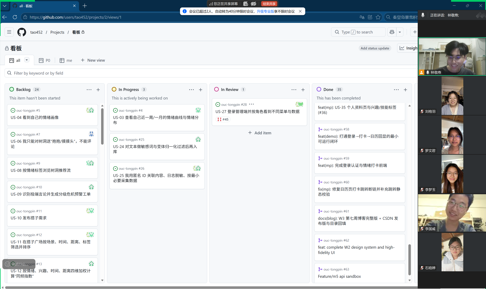

# 第七周 Scrum Meeting 会议记录

> 周期：11/03 – 11/08（Alpha 冲刺第三周 / W3）
> 迭代：Alpha v0.1 / S1（11 个故事，55 故事点，11/15 到期，W1–W4）
> 形式：线上异步协作 + 周例会，进度以 GitHub Issue / Project 看板沉淀
> 仓库：https://github.com/tao452/ouc-tongpin

## 〇、本周基本信息

| 项    | 内容                                                                                                                      |
| ---- | ----------------------------------------------------------------------------------------------------------------------- |
| 迭代   | Alpha v0.1 / S1（11 个故事，55 故事点，11/15 到期）                                                                                 |
| 本周周期 | 第七周 11/03 – 11/08（冲刺 W3）                                                                                                |
| 例会时间 | 2026-11-08（周日）线上周例会                                                                                                     |
| 参会   | M1林敬焘（tao452）、M2罗文君（mimisoup）、M3李梦玉（Gnemyu）、M4刘格羽（lgy-wch）、M5李国威 （Raylee06）、M6石晗婷（ATmixiu）                              |
| 缺席   | 无                                                                                                                       |
| 本周产出 | 11 条 PR合入 `develop`：#54、#55、#57、#58、#59、#60、#62、 #63、#64、#65、#66；W2 博客已发布 CSDN；`develop` 上 CI 全绿                        |
| 看板   | 目标：V0.1 未关故事本周逼出 PR；实际：#34 于 11/08 被 #62 关单；合入 4 条 PR 后，#64 补齐建表 SQL、#65 的容器 CI 真跑通落库链路，三条关单获证据追认，W3 末剩 5 条 open，目标部分达成 |

### 本周例会议题

1. V0.1 收尾盘点：八条未关故事逐条过责任人 / 分支 / 卡点，定死 PR 交付日到人。
2. 登录与打卡链路打通方式：M1 演示桩（PR#58）与 M3 正式前端（PR#59）如何衔接，避免路由重复。
3. 评审纪律落地：PR#59 首次非作者评审后合入，验证「作者不自审自合」决议可执行。
4. 跨文件跳转断链自动校验：PR#60 给 `check-project.cjs` 加静态校验，CI 兜底。
5. 11/15 V0.1 可演示范围确认：砍功能不砍质量；真微信登录降级为测试号 + mock 学号。

## 一、每人工作

| 成员          | 状态  | 已完成的工作（本周 11/03–11/08）                                                                                                                                                                                                                                                                                                                                                                                                                                                                                                                                                                                                                                       | 计划完成的工作                                                                        | 遇到的困难                                                                                                        |
| ----------- | --- | ------------------------------------------------------------------------------------------------------------------------------------------------------------------------------------------------------------------------------------------------------------------------------------------------------------------------------------------------------------------------------------------------------------------------------------------------------------------------------------------------------------------------------------------------------------------------------------------------------------------------------------------------------------ | ------------------------------------------------------------------------------ | ------------------------------------------------------------------------------------------------------------ |
| M1 tao452   | 进行中 | 功能：完成 #36 US-35 个人资料页（PR#57，+433/−6）——`pages/profile/` 四件套 + 首页入口 + 契约 `PUT /api/user/profile` 对齐 + 7 单测，全仓 14/14 pass；并在 #36 补 DoR 第 4 条业务口径。流程：打通「登录→打卡→日历回显」演示闭环（PR#58，+504/−44，后端 DemoAuthController / EmotionWordController + 小程序打卡页 + `config.js` 改 dev 指向 127.0.0.1:8080，CI 含全栈 7 条 HTTP 冒烟全过）；修复 PR#59 带来的日历页跳转断链并补静态校验（PR#60，+42/−3）；W2 博客 11/06 发布 CSDN；PR#55 文档类交付合入（W2 发布版 + W3 骨架 + 目录回填）；11/08 夜间补 PR#64（建表 SQL + compose 初始化挂载，+85/−1，修 `users` 保留字表名）；作为属主 24h 内评审并 merge M3 的 PR#59，另对齐 #63 后端契约、对 #65/#66 做非作者评审后 squash 合入。（未完成：#36 后端接口未落地、保存暂走本地缓存，M3 复核未完成故 Issue 暂不关；演示登录为固定 token，无 code2session/JWT/学号认证；打卡已接 MySQL 持久化但身份仍写死 `1L`） | 待 M5 接口落地后联调 #36；例会把 V0.1 八条故事的 PR 交付日定死到人；保持 PR 24h 评审；迭代末汇总 S1 博客素材          | Issue 多数赶DDL，需例会现场逼各模块出 PR                                                                                   |
| M2 mimisoup | 进行中 | 提交 PR#62（11/08）「完成 W2 设计系统与高保真 UI」（+462/−0，28 文件）—— US-34 设计系统：12 屏高保真（打卡/树洞/校园广场各 4 屏）+ 8 基础组件 + `design/spec.md`，Closes #34；CI 全绿。但交付物为 Figma 设计资产与规范文档，小程序可 import 的组件库代码仍未开工                                                                                                                                                                                                                                                                                                                                                                                                                                                                             | 交付小程序组件库代码（可 import 的目录 + 至少 2 个通用组件），替换设计稿占位                                  | 设计规范已出，组件库代码仍未开工，前端公共地基缺；M3 拼页面靠手写样式                                                                         |
| M3 Gnemyu   | 进行中 | 提交 PR#59（11/08）「完成登录认证与情绪打卡前端」（+2442/−349，47 commits）——重写打卡模块为 `pages/checkin/{index,form,rule,records,result}`、新增 tabBar、学号认证页、登录 Promise + loginReady；复用 `utils/checkin.js`，接口对齐 openapi 契约；CI 全绿（19 单测）。经 M1 非作者评审后合入，是本周最大功能进展                                                                                                                                                                                                                                                                                                                                                                                                                           | 情绪曲线 US-03 开工（可复用 `GET /api/emotions/checkins`）；树洞/搭子页达到可演示；给页面状态流转补单测         | 依赖 M5 后端接口（登录/学号认证/打卡持久化），目前登录仍走 M1 的演示桩；US-03 至今无分支（最危险）                                                    |
| M4 lgy-wch  | 进行中 | 11/08 提交 PR#66（+127/−0）「US-29 校园情绪热力图与趋势」——ECharts 7 天×4 时段热力图，CI 的 admin-web job 通过，`Closes #30`；合入前由 M1 解 `Login.vue` 的 add/add 冲突（PR 分支那份是 GBK 乱码损坏版，保留 develop 正确中文版）。US-27 登录菜单（V1.0 P0）、US-37 数据看板（V2.0 P1）不在 V0.1 关键路径                                                                                                                                                                                                                                                                                                                                                                                                                                | 把 `Heatmap.vue` 接入路由/App.vue（当前为孤立组件，页面不可访问）；管理端接入 `vue-router`、把 mock 替换为真实接口 | `Heatmap.vue` 未被任何路由引用，合入后暂不可访问；管理端真实接口依赖 M5 后端，当前以 mock 演示为主                                                |
| M5 Raylee06 | 进行中 | 11/08 提交 PR#63（+686/−295，36 文件）「W2 认证打卡 + W3 树洞焚毁核心业务」——US-01 打卡幂等、US-05 树洞发布/列表、US-07 Redis ZSet 24h 焚毁队列；合入前由 M1 删同名控制器与 demo 桩、把路径与裸返回体对齐 openapi 契约。其沙盒分支早在 11/01（W2）以 PR#47 合入 develop（AuthController + JwtUtil、持久化打卡、脱敏工具、全局异常处理、compose 编排）                                                                                                                                                                                                                                                                                                                                                                                                           | 补 JWT 登录拦截器替换写死 `userId=1L`；给 `checkin` 表加每日唯一索引并验证幂等；定稿 ER 图与 openapi v0.1    | #63 曾与 develop 演示桩同名 bean / 同路径冲突，已删桩对齐；起初全仓无建表 SQL、首次落库即失败（#64 已补、#65 容器回归已核对写入）；正式登录/JWT 拦截器仍未接；ER 图/契约未定稿 |
| M6 ATmixiu  | 进行中 | PR#54（11/04）补齐两端质量门禁与评审记录（+3630/−210）；11/08  PR#65（+1093/−49，32 文件）「M6 W2 内容安全开发交付与容器回归」——修敏感词漏检/误杀、树洞落库前调真实审核（HIGH→422 / 不可用→503 / 正常→201）、300 条合成回归样本、修无日期打卡 smoke 失败；用 `Refs #25` 未误关故事                                                                                                                                                                                                                                                                                                                                                                                                                                                                   | #25 按业务场景验收后关单（代码已由 #65 合入）、#26 PII 扫描、#33 测试环境验收；执行 80 条用例中的高优先级部分            | 共享 issue 口径需与 M1/M5 对齐；#25/#26/#33 代码已在 develop，差业务验收与关单；树洞前端本地 mock 与真实审核的端到端联调待做                           |

## 二、每人代码 / 文档签入记录

> 每条须能对上 Issue 编号并点开验证；真没有就如实写「本周无代码产出，原因：…」。

**M1 林敬焘（tao452）**

- PR#55 (11/07) `docs(blog): 第六周 CSDN 发布版 + 第七周 W3 博客骨架与目录回填` · Refs #36 · https://github.com/tao452/ouc-tongpin/pull/55
  - 变更 3 个文档：第六周 CSDN 发布版、第七周 W3 骨架、目录回填发布链接；纯文档，无功能代码。
- PR#57 (11/07) `feat(mp): US-35 个人资料页与兴趣/技能标签 (#36)` · Refs #36 · https://github.com/tao452/ouc-tongpin/pull/57
  - 新增 9 个文件：`pages/profile/` 四件套、`utils/profile.js`、`tests/profile.test.cjs`（7 用例）；本地 14/14 单测、eslint 无警告、项目配置检查 4 页有效；已在 #36 补 DoR 第 4 条业务口径；Refs 非 Closes。
- PR#58 (11/07) `feat(demo): 打通登录→打卡→日历回显的最小可运行闭环` · Refs #2/#33/#34 · https://github.com/tao452/ouc-tongpin/pull/58
  - 后端 `DemoAuthController` / `EmotionWordController`、小程序打卡页、`utils/checkin.js` + 5 单测、`config.js` 改 `dev`；CI 含 `api-server` mvn verify 与全栈 7 条 HTTP 冒烟全绿。
- PR#60 (11/08) `fix(mp): 修复日历页打卡跳转断链并补充跳转静态校验` · Refs #59 · https://github.com/tao452/ouc-tongpin/pull/60
  - 日历页改 `wx.switchTab('/pages/checkin/index')`；`check-project.cjs` 新增跳转目标注册校验；CI 全绿。
- 11/06 12:57 将第六周 Scrum 博客公开发布 CSDN（原创 / 全部可见）：https://blog.csdn.net/2501_90092470/article/details/170191783
- PR#64 (11/08 20:09) `feat(db): 补充 V0.1 建表 SQL 并挂载 docker-compose 初始化` · Refs #2/#6/#8 · https://github.com/tao452/ouc-tongpin/pull/64
  - +85/−1：新增 `infra/db/init/01-schema.sql`（users/auth/checkin/treehole_post/treehole_archive 五表，幂等 `CREATE TABLE IF NOT EXISTS`）、compose 挂载 init 目录、User 实体改 `@TableName("users")` 避开 MySQL 保留字；PR 描述当时要求「三故事仍需真跑通验收」；当晚 #65 的容器 CI 已补齐该证据，三条关单予以追认。

**M2 罗文君（mimisoup）**

- PR#62 (11/08) `feat(design): 完成 W2 设计系统与高保真 UI（US-34）` · Closes #34 · https://github.com/tao452/ouc-tongpin/pull/62
  - +462/−0，28 文件：12 屏高保真、8 基础组件、`design/spec.md` / `design/ia.md`；CI 全绿。

**M3 李梦玉（Gnemyu）**

- PR#59 (11/08) `feat(mp): 完成登录认证与情绪打卡前端` · Refs #2/#34 · https://github.com/tao452/ouc-tongpin/pull/59
  - 47 commits / +2442/−349：重写打卡模块、tabBar、学号认证页、登录 Promise；复用 `utils/checkin.js`，接口对齐 openapi；19/19 单测；M1 非作者评审后合入。

**M4 刘格羽（lgy-wch）**

- PR#66 (11/08 21:36) `[US-29] 校园情绪热力图与趋势` · Closes #30 · https://github.com/tao452/ouc-tongpin/pull/66
  - +127/−0：新增 `apps/admin-web/src/views/Heatmap.vue`（ECharts 7 天×4 时段热力图）；合入前由 M1 解 `Login.vue` 的 add/add 冲突（PR 分支那份是 GBK 乱码损坏版，保留 develop 正确中文版）；CI 的 admin-web job 通过。US-29 属 V1.0，不计入 V0.1 的 11 个故事。

**M5 李国威（Raylee06）**

- PR#63 (11/08 19:43) `Feature/m5 api sandbox` · Closes #2/#6/#8（起初缺建表 SQL，当晚补齐证据后追认） · https://github.com/tao452/ouc-tongpin/pull/63
  - +686/−295，36 文件：US-01 打卡幂等、US-05 树洞发布/列表、US-07 Redis ZSet 24h 焚毁队列；合入前由 M1 删同名控制器与 demo 桩、把路径与裸返回体对齐 openapi 契约。

**M6 石晗婷（ATmixiu）**

- PR#54 (11/04) `[W1/M6] 补齐两端质量门禁与评审记录` · https://github.com/tao452/ouc-tongpin/pull/54
  - +3630/−210：CI yaml、W1 质量门禁/治理记录、admin-web 3 测试、miniprogram request 测试。
- PR#65 (11/08 20:56) `feat(algo): 完成 M6 W2 内容安全开发交付与容器回归` · Refs #25 · https://github.com/tao452/ouc-tongpin/pull/65
  - +1093/−49，32 文件：修敏感词漏检/误杀、树洞写 MySQL/Redis 前调真实审核（HIGH→422、不可用→503、正常→201）、300 条合成回归样本（召回 ≥95%、误杀 <2%）、修无日期打卡 smoke 失败；CI 全绿，用 `Refs` 未误关故事。

> 本周共合入 11 条 PR（#54/#55/#57/#58/#59/#60/#62/#63/#64/#65/#66），6 人全员有签入。#56 为撤回PR，已 CLOSE，不计入。

| 成员          | Issue          | PR                  | 分支 commits | 文档产出                   |
| ----------- | -------------- | ------------------- | ---------- | ---------------------- |
| M1 tao452   | #36 / #2/#6/#8 | #55、#57、#58、#60、#64 | 33         | W2 发布版、W3 骨架、目录、建表 SQL |
| M2 mimisoup | #34            | #62                 | —          | 设计系统/高保真               |
| M3 Gnemyu   | #2/#34         | #59                 | 47         | —                      |
| M4 lgy-wch  | #30            | #66                 | 3          | —                      |
| M5 Raylee06 | #2/#6/#8       | #63                 | 9          | —                      |
| M6 ATmixiu  | #25/#26/#33    | #54、#65             | 35         | W1 质量门禁/治理记录、W2 内容安全交付 |
| **合计**      | —              | **11**              | —          | —                      |

## 三、燃尽图

| 数据点         | 剩余故事 | 说明                                                                                                |
| ----------- | ---- | ------------------------------------------------------------------------------------------------- |
| W1 初（10/21） | 11   | V0.1 迭代开始，S1 共 11 个故事 / 55 故事点                                                                    |
| W1 末（10/26） | 11   | 地基期（CI / 契约 / 指南），无故事关闭                                                                           |
| W2 末（11/02） | 9    | 与 W2 博客记录的 8 存在口径差，实际未关为 9                                                                        |
| W3 末（11/08） | 5    | #34 经 #62 关单；#2/#6/#8 起初缺建表 SQL，经 #64 补表 + #65 容器 CI 核对真实写入后追认关单；#66 关的 #30 属 V1.0 US-29，不计入 V0.1 |
| W4 末（11/15） | —    | V0.1 迭代到期，理想线归零                                                                                   |

> 说明：本燃尽图展示的是 V0.1 迭代整体（11 个故事 / 55 故事点，W1–W4）。理想线从 W1 初的 11 线性降至 W4 末的 0；实际线 W2 末（11/02）为 9（W2 博客记录的 8 存在口径差，实际含 #34 未关）、W3 末（11/08）为 5（#34 经 #62 关单，#2/#6/#8 在补齐证据后追认关单）。#63 合入当时三条由 `Closes` 机械关单且全仓无建表 SQL、首次落库即失败；当晚 #64 补表、#65 容器回归核对真实写入后，三条关单获证据追认，不再按未完成统计，故实际线由 8 降至 5。

## 四、例会照片

## 五、本周决议

1. **评审纪律落地**：PR#59 由 M1 非作者审批后合入，首次符合「每个 PR 24h 内至少 1 次非作者评审、作者不自审自合」决议；往后 M1 自己的 PR 仍走 admin 但如实记录，不写成「经评审合入」。
2. **登录 / 打卡链路衔接**：M1 演示桩（PR#58 的 `DemoAuthController`）与 M3 正式前端（PR#59）并行；M5 正式 `AuthController` 提 PR 前需先与 develop 上的演示桩对路由后替换，避免 `/api/auth/login` 重复映射。
3. **断链自动校验**：PR#60 给 `scripts/check-project.cjs` 加页面跳转静态校验（目标页须注册、tabBar 页须 `switchTab`），将跨文件跳转错误从「人工发现」前移为「CI 拦截」。
4. **V0.1 收尾责任到人**：例会定死每条故事的 PR 交付日。
5. **真微信登录降级**：演示用微信测试号 + mock 学号校验，不卡真认证，保证 Alpha 阶段演示链路可走通。
6. **关单须附证据链**：#2/#6/#8 曾由 `Closes` 机械关单、当时无建表 SQL；11/08 夜间 #64 补齐 5 张表、#65 的容器 CI 真实核对 MySQL/Redis 写入后，三条关单获证据追认，不重开。决议往后每条故事须附「建表 → 端到端真跑通 → 非作者复核」证据才允许关单，PR 一律用 `Refs`；4 项遗留（JWT 身份、每日唯一索引、焚毁到期验证、树洞前端接线）列入 W4。

## 六、困难与难点

- **产出集中在周最后一天**：PR 提交集中于周最后一天，6 人全员有签入。M2 的设计系统资产（#62）已合入但可 import 组件库代码仍缺；Alpha 阶段到期只剩 7 天，V0.1 收尾仍偏紧。
- **管理员合并例外**：M1 的 #55/#57/#58 用 `--admin` 绕过自审（#59 是 M3 的、正常评审；#60 作者为 M1 仍走 admin）。本博客如实记录，未写成「经评审合入」。
- **燃尽图口径差**：W2 博客记 8、实测 9（含 #34），W3 末 #34 与另 3 条关单后剩 5；其中三条曾因缺建表 SQL 被判「假关闭」，经 #64 补表 + #65 容器回归核对真实写入后予以追认，PNG 按 W3 末 5 重绘。
- **打卡状态不刷新**：M3 PR#59 的 `hasCheckedIn / continuousDays / totalDays` 从不从接口刷新，打卡后回首页仍显示「今日尚未打卡」，待修。
- **验收覆盖仍有 4 个缺口**：① 控制器 `userId` 写死 `1L`、JWT 拦截器未接（容器报告 scope 明确为 demo user 1）；② `checkin` 表缺 `UNIQUE(user_id, checkin_date)`，每日幂等的 `DuplicateKeyException` 兜底实际不会触发；③ 24h 焚毁只验证了 Redis ZSet 入队，`BurnTask` 到期扫描 / 软删除 / 哈希留档未端到端跑过；④ 小程序树洞页仍是「树洞正在准备中」空壳。 学号认证 `/api/auth/student-verify` 后端亦未实现；已起过容器环境须 `docker compose down -v` 清卷重起才会执行建表脚本。

## 七、风险与应对

| 风险                  | 触发条件             | 影响                                           | 应对                                 |
| ------------------- | ---------------- | -------------------------------------------- | ---------------------------------- |
| 11/15 前无法交付可运行小程序   | PR赶DDL           | 只剩小程序空壳+零散页                                  | 定死每条 PR 日期；先保 1 条端到端闭环（登录→打卡→回显已通） |
| 契约 / ER 图 / 组件库未定稿  | M5/M2 未交付        | M3/M4 继续 mock，无法联调                           | 冻结登录、打卡、树洞 3 接口；组件库示范接入 1 页        |
| US-33 微信登录缺真实 AppID | 无测试号             | 登录链路演示跑不通                                    | 演示用微信测试号 + mock 学号校验               |
| 本地环境不一致             | 配置变更未同步          | 成员本地跑不起来误判为代码问题                              | 统一 `.env` + 迁移说明，以 CI 为唯一基线        |
| 关单证据链不全             | 仅凭代码合入或单次容器回归即关单 | JWT / 唯一索引 / 焚毁到期 / 前端接线 4 项遗留，在 11/15 演示时暴露 | 逐项补齐并留证；后续一律 `Refs` + 验收后手动关单      |

## 八、高兴的地方

- **PR#59（M3）完成登录认证与情绪打卡前端**（+2442 行、47 commits），是本周最大功能进展，且首次走「非作者评审后合入」，评审纪律开始真正落地。
- **M1 打通登录→打卡→日历回显演示闭环（PR#58）**，CI 全绿（含全栈 7 条 HTTP 冒烟），小程序首次能跑通不依赖 Apifox mock 的真实链路。
- **PR#60 把跨文件跳转断链从人工发现变为 CI 自动拦截**，质量门禁前移，同类问题不会再漏过。
- **W2 博客已按时发布 CSDN**（11/06），公开可查、带发布时间戳。
- 6 人中 4 人（M1/M2/M3/M6）在例会前已有合入（M2 为设计系统资产）；11/08 夜间 M4/M5 也各合入一条，全周 11 条 PR、6 人全员有签入。
- **11/08 补上后端三块地基**：M5 的 #63 打通打卡/树洞/焚毁接口并对齐契约、M1 的 #64 补齐 5 张建表 SQL、M6 的 #65 让树洞发布接上真实内容审核（HIGH→422 / 不可用→503）；#65/#66 均走非作者评审后 squash 合入；此前的「假关闭」也在同晚由建表 SQL 与容器回归补齐证据，三条关单获追认，V0.1 剩余故事由 8 降至 5。

## 九、下周（W4 / S1 第四周，11/15 V0.1 收尾）计划与验收标准

- [ ] **M5**：补 JWT 登录拦截器替换写死 `userId=1L`；给 `checkin` 表加 `UNIQUE(user_id, checkin_date)` 并验证每日幂等；定稿 ER 图与 openapi v0.1。
- [ ] **M3**：US-03 情绪曲线开工、树洞/搭子页达到可演示、补页面状态流转单测。
- [ ] **M2**：组件库代码交付并至少接入一个页面。
- [ ] **M4**：把 #66 的 `Heatmap.vue` 接入路由/App.vue（当前孤立组件）；管理端路由 + 真实接口替换完成，可演示。
- [ ] **M6**：#25 按六场景业务验收后关单（代码已由 #65 合入）、#26 PII 扫描、#33 测试环境验收；80 条用例高优先级部分执行。
- [ ] **M1**：#36 联调；V0.1 可运行演示环境（US-32 一键起环境）串通；迭代末汇总 S1 博客素材与发布记录。
- [ ] **M1 / 全组**：补 24h 焚毁到期执行的端到端验证（可用时间加速）、把树洞前端接上真实接口；`docker compose down -v` 清卷重起复验建表脚本；往后关单须附「建表 → 端到端真跑通 → 非作者复核」证据链。
- [ ] **全组**：11/15 前确认 V0.1 可演示范围，砍功能不砍质量。
