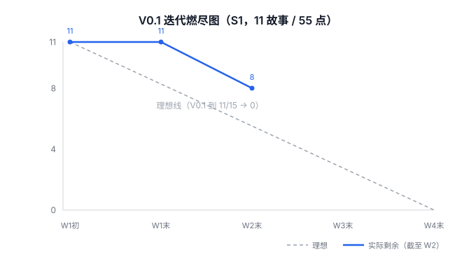
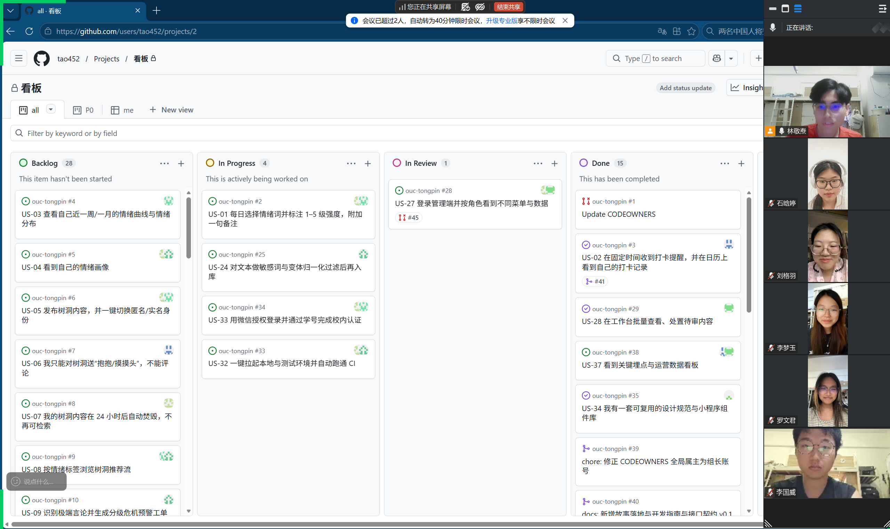

# 第六周 Scrum Meeting 会议记录

> 周期：10/28 – 11/02（Alpha 冲刺第二周 / W2）
> 本冲刺整体为 **10/21 – 11/02**，含 W1（10/21–10/26，第五周）与 W2（10/28–11/02，第六周）两段
> 形式：线上异步协作 + 周例会，进度以 GitHub Issue / Project 看板沉淀
> 仓库：https://github.com/tao452/ouc-tongpin

## 〇、本周基本信息

| 项 | 内容 |
|---|---|
| 迭代 | Alpha v0.1 / S1（11 个故事，55 故事点） |
| 本周周期 | 第六周 10/28 – 11/02（冲刺 W2） |
| 例会时间 | 2026-11-01（周日）线上周例会 |
| 参会 | M1 林敬焘、M2 mimisoup、M3 Gnemyu、M4 lgy-wch、M5 Raylee06、M6 ATmixiu |
| 缺席 | 无 |
| 本周产出 | 10 条 PR 合入 `develop`：#41、#42、#43、#44、#46、#47、#48、#49、#50、#51（#45 因重复关闭）；`develop` 上 CI 全绿 |
| 看板 | 目标：每人至少 1 条 S1 故事进入 In Progress；实际：US-02 / US-28 / US-34 已关闭，其余故事在 In Progress / In Review |

> 本周不开每日站会：日常进度靠 Projects 看板拖动与 Issue 评论异步同步，周例会只处理「进展 / 计划 / 卡点 / 需要跨人协调的事」。

### 本周例会议题

1. 各条线进展与卡点：M2 设计规范、M3 小程序工程、M4 管理端三页、M5 后端环境、M6 安全地基。
2. 依赖阻塞如何解：M5 的 ER 图与接口契约、M2 的组件库，直接决定 M3 能否开工业务页面。
3. 管理端脚手架缺失导致 CI 失败的处理方式，以及模块检查的触发规则。
4. 内容审核的等级口径：HIGH / MEDIUM / LOW 分别对应阻断还是提示。
5. 评审与合入纪律：draft PR 何时转正、谁来做非作者评审、合并后如何确认 CI。

## 一、每人工作（含 Issue 链接）

| 成员 | 状态 | 已完成的工作（本冲刺 10/21–11/02） | 计划完成的工作 | 遇到的困难 |
|---|---|---|---|---|
| M1 林敬焘 | 进行中 | **W1**：修复 CI `guard` 永远失败（`git log --no-merges`）#39；产出《故事落地与开发指南》+ 接口契约 v0.1 #40。**W2**：US-02 打卡日历页+提醒骨架+后端 checkins 接口种子 #3（PR#41）；站会裁剪为周例会+周报模板 #42 | 推进 #36 US-35 个人资料；跟进 #7 / #38；作为属主完成 PR 评审 | 本地 clone 遇 SSH 22 拒绝、HTTPS 证书吊销，已用 `sslVerify=false` + HTTPS 绕过 |
| M2 mimisoup | 进行中 | **W2**：提交 PR#46 设计规范文档+竞品分析+全模块线框图（#35 US-34 的设计地基部分）；小程序组件库代码待启动 | 基于已定规范搭建小程序组件库骨架 | 设计规范已出，但组件库代码尚未开工，前端公共地基仍缺 |
| M3 Gnemyu | 进行中 | **W2**：提交 PR#48 初始化小程序工程（登录流程 + 多环境配置 + 工具链 eslint/prettier/husky + logs/storage/util 工具）；认领 S1 #2/#4/#34/#11/#6 | 等 M5 环境与 M2 组件库后开工情绪/搭子/树洞页面 | 脚手架已就绪，但依赖 M5 环境+契约、M2 组件库方可联调业务页面 |
| M4 lgy-wch | 进行中 | **W1**：研读 openapi.yaml 的 admin 分组，准备管理端。**W2**：管理端三个页面（数据看板 #38 / 登录 #28 / 审核 #29），均 mock 演示，已合入 develop（PR#43、PR#44） | 将页面接入 vue-router；待契约定稿后替换 mock 为真实接口 | PR#43 初版 `apps/admin-web` 缺工程脚手架导致 CI 失败，已由 M1 补齐后转绿 |
| M5 Raylee06 | 进行中 | **W2**：提交 PR#47 初始化后端依赖（MySQL/Redis）+ 数据库配置 + Docker 环境（#33 环境地基）；ER 图与接口契约在制定中 | 定稿 ER 图与 openapi 契约、补全后端骨架（US-32/US-25/US-07） | 环境已起步，但 ER 图/契约未定稿，M3 前端仍被阻塞 |
| M6 ATmixiu | 进行中 | **W2**：提交 PR#49 安全地基 S1（新建算法审核服务 `services/algo`：敏感词分级过滤；Java 审核客户端 + HMAC 匿名 ID + 日志脱敏；Compose 全栈与 nginx HTTP 冒烟 CI）· Refs #25/#26/#33；**11/02 评审通过并合入 develop**（101 项 Python 测试、40 项 Java 测试、本地全栈 smoke 通过）；另提交 PR#50 统一 9 份文档进度与待办表述；PR#51 记录 nightly 首次执行与 80 条功能用例首轮结果（37 PASS / 2 FAIL / 2 BLOCKED / 39 NOT_RUN） | 推进 #25/#26/#33 真实业务验收（正式词库、PII 扫描、测试环境） | 共享 issue 口径需与 M1/M5 对齐；80 条用例首轮已执行（2 项 M5 打卡参数校验 FAIL 待修复后复测） |

## 二、每人代码 / 文档签入记录（对应 Issue 链接）

- **M1 tao452**
  - PR#39 (10/26) `chore: 修正 CODEOWNERS 全局属主` · 关联 #39 · https://github.com/tao452/ouc-tongpin/pull/39
  - PR#40 (10/27) `docs: 故事落地指南 + 接口契约 v0.1` · 关联 #40 · https://github.com/tao452/ouc-tongpin/pull/40
  - PR#41 (10/31) `feat(mp+api): US-02 打卡日历页与提醒骨架 + 后端 checkins 接口种子` · 关联 #3 · https://github.com/tao452/ouc-tongpin/pull/41
  - PR#42 (10/31) `docs: 站会改为每周例会+异步看板，新增周例会模板与博客骨架` · https://github.com/tao452/ouc-tongpin/pull/42
- **M4 lgy-wch**
  - PR#43 (11/01) `feat(admin): 完成 US-37 数据看板页面 + build(admin): 补齐脚手架` · 关联 #38 · https://github.com/tao452/ouc-tongpin/pull/43
  - PR#44 (11/01) `feat(admin): 完成 US-27 登录菜单 (#28) + US-28 审核工作台 (#29)` · https://github.com/tao452/ouc-tongpin/pull/44
- **M2 mimisoup**
  - PR#46 (11/01) `docs: 设计规范文档 + 竞品分析 + 全模块线框图` · 关联 #35 · https://github.com/tao452/ouc-tongpin/pull/46
- **M5 Raylee06**
  - PR#47 (11/01) `chore: 初始化后端依赖、数据库配置及 Docker 环境` · 关联 #33 · https://github.com/tao452/ouc-tongpin/pull/47
- **M3 Gnemyu**：PR#48 (11/01) `feat(m3): initialize miniprogram project` · 小程序工程初始化（登录流程/多环境配置/工具链）· https://github.com/tao452/ouc-tongpin/pull/48
- **M6 ATmixiu**：PR#49 (11/01) `feat(algo): M6 内容过滤、隐私工具与全栈验证（S1）` · Refs #25/#26/#33 · **11/02 由 M1 审核通过并 merge（`db004f9`），develop CI 全绿** · https://github.com/tao452/ouc-tongpin/pull/49
  - PR#50 (11/02) `docs: 调整仓库进度与待办表述` · Refs #25/#26/#33 · 同步 #49 已合状态、统一 9 份文档进度说明 · https://github.com/tao452/ouc-tongpin/pull/50
  - PR#51 (11/02) `test: 记录 nightly 与现有功能用例执行` · Refs #25/#26/#33 · 首次 nightly 手动运行成功、80 条目录用例执行（37 PASS / 2 FAIL / 2 BLOCKED / 39 NOT_RUN，2 个 FAIL 为 M5 打卡参数校验待办）；新增 `scripts/qa/` 执行脚本与证据入库 · https://github.com/tao452/ouc-tongpin/pull/51

> 本周共合入 10 条 PR（#41/#42/#43/#44/#46/#47/#48/#49/#50/#51）。#45（US-27 登录菜单）因与 #44 内容重复且分支冲突关闭，相关改动已由 #44 承接。

| 成员 | 本周 PR | 主要模块 |
|---|---|---|
| M1 林敬焘 | #41、#42 | 小程序打卡日历页 + 后端 checkins 接口；例会与博客流程 |
| M2 mimisoup | #46 | 设计规范、竞品分析、全模块线框图 |
| M3 Gnemyu | #48 | 小程序工程初始化、多环境配置、工具链 |
| M4 lgy-wch | #43、#44 | 管理端数据看板、登录、审核（mock） |
| M5 Raylee06 | #47 | 后端依赖、数据库配置、Docker 环境 |
| M6 ATmixiu | #49、#50、#51 | 算法审核服务、隐私工具、全栈编排与 CI；文档进度同步；nightly 与功能用例执行记录 |
| **合计** | **10** | 6 人全部有签入 |

## 三、燃尽图

| 数据点 | 剩余故事 | 说明 |
|---|---|---|
| W1 初（10/21） | 11 | V0.1 迭代开始，S1 共 11 个故事 / 55 故事点 |
| W1 末（10/26） | 11 | 地基期（CI / 契约 / 指南），无故事关闭 |
| W2 末（11/02） | 8 | US-02 / US-28 / US-34 关闭，实际线当前位置 |
| W3 末（11/09） | — | 待后续周报补充 |
| W4 末（11/15） | — | V0.1 迭代到期，理想线归零 |

> 说明：本燃尽图展示的是 **V0.1 迭代整体**（11 个故事 / 55 故事点，到期 11/15，约 W1–W4），并非仅 W1–W2 的任务。理想线从 W1 初的 11 线性降至 W4 末的 0；截至本 W2 周报（11/02），实际剩余 8 个故事（US-02 / US-28 / US-34 已关闭），W3 / W4 进度待后续周报补充。未关闭的 8 个故事仍在 In Progress / In Review，不作已完成统计。

## 四、例会照片

## 五、本周决议

1. **内容审核口径**：S1 阶段按「HIGH 阻断、MEDIUM/LOW 提示放行」执行，与 `services/algo` 当前实现一致；正式词库、等级划分与独立标注集评估仍由 #25 在后续迭代验收。
2. **工程基线**：全仓库统一 Java 17；提交信息必须符合 `<类型>(<范围>): <描述>`；PR 必须过 guard / 模块检查 / quality 三道门禁。
3. **环境与契约**：M5 在 S2 首周定稿 ER 图与 openapi v0.1，并在 Apifox 开启 Mock；管理端现有 mock 数据待契约稳定后替换。
4. **评审纪律**：每个 PR 24 小时内至少 1 次非作者评审；作者不自审自合，合入后确认 `develop` 的 CI 结果。
5. **卡点升级**：依赖未就绪（M5 契约/ER 图、M2 组件库）在例会当场升级给对应负责人，不留在个人手里过夜。

## 六、困难与难点

- **CI 自动化检查永远失败（W1）**：GitHub 在合并 PR 时生成"自动合并提交"，导致 `git log origin/develop..HEAD` 始终含合并提交，`guard` 作业误判为非常规提交而 FAIL。修复：CI 脚本加 `--no-merges`。
- **本地协作环境不通（W1）**：部分成员 clone 时遇 SSH 22 端口拒绝、HTTPS 证书吊销检查失败。统一改用 HTTPS + 关闭 `sslVerify` 缓解。
- **管理端缺脚手架致 CI 失败（W2）**：M4 的 PR#43 仅提交了 `DataBoard.vue`，`apps/admin-web` 无 `package.json` / `package-lock.json`，CI 的 `npm ci` 直接失败。由 M1 补齐 Vite+Vue3+ElementPlus+ECharts 脚手架并修正 lint/test 占位脚本后，PR#44 的 admin-web CI 一次转绿。
- **前端仍受依赖阻塞**：M2 组件库、M5 环境/契约未完全就绪，M3 虽已起小程序工程（#48），但情绪/搭子/树洞等业务页面仍需等依赖到位才能联调。
- **提交规范与 JDK 版本纪律（W2）**：M5 的 PR#47 初版把 `<java.version>` 改为 21、且提交信息缺 conventional 前缀，导致 guard 与 api-server 双红；已统一回 Java 17 并补 `chore:` 前缀后转绿。提醒全员：仓库约定 Java 17、提交信息需 `类型: 描述`。
- **跨模块配置变更需要同步（W2）**：PR#49 调整了 Compose 的数据库名（`ouc_tongpin`）、MySQL 宿主端口（3307）与容器命名方式，会影响成员本地已有环境；已在合入说明中给出迁移步骤，S2 首日统一按新 `.env` 重新拉起。
- **Docker Hub 直连不稳定（W2，环境侧）**：拉取基础镜像时出现 IPv6 超时，已通过配置镜像源解决；CI runner 不受影响。

## 七、风险与应对（S2 前瞻）

| 风险 | 触发条件 | 影响 | 应对 |
|---|---|---|---|
| 契约 / ER 图仍未定稿 | M5 未在 S2 首周交付 | M3、M4 只能继续 mock，无法联调 | 例会定死交付日；先冻结登录、打卡、树洞 3 个核心接口 |
| 组件库缺位 | M2 只交设计不交代码 | 各页面重复实现，风格不统一 | S2 首周交付基础组件并示范接入一个页面 |
| 80 条用例始终未执行 | 依赖一直未就绪 | 无法证明功能可用，答辩被动 | 先执行不依赖后端的 P0 用例，逐条记录证据 |
| 本地环境不一致 | 配置变更未同步 | 成员本地跑不起来，误判为代码问题 | 统一 `.env` + 迁移说明，以 CI 结果作为唯一基线 |
| 进度压力 | 期末临近 | 范围失控、质量下滑 | 每迭代末只承诺可演示范围，砍功能不砍质量 |

## 八、高兴的地方

- 工程地基（CI / 开发指南 / 接口契约 / 协作节奏）在第一周就由 M1 铺好，后续开发有章可循。
- M4 在 W2 连续提交并合入 2 条 PR，管理端有了可见成果，一扫"S1 空档"的顾虑。
- M2、M3、M5、M6 也在 W2 交出首条 PR（设计规范 #46、小程序工程 #48、后端环境 #47、安全地基 #49），团队六人全部产生实际签入，协作真正铺开。
- US-02 端到端打通（小程序日历页 + 后端 checkins 接口），验证了"契约先行 + Mock 驱动"路线的可行性。
- M6 的安全地基 PR#49 走了完整评审：转正草稿 → 非作者 approve → merge，101 项 Python 测试与 40 项 Java 测试通过，本地全栈 5 个容器 healthy、7 项 smoke 全过，是本周质量最高的一条签入；同期 US-28、US-34 经评审确认关闭，S1 已完成 3 个故事，团队由「地基」转入「业务实现」阶段。
- 团队协作顺畅：异步看板 + 周博客运转正常，问题能在周报里及时暴露。

## 九、下周（S2 首周）计划与验收标准

- [ ] **M5**：定稿 ER 图与 openapi v0.1，导入 Apifox 并开 Mock；补齐后端骨架（US-32 / US-25 / US-07），解除 M3 的前端阻塞。
- [ ] **M3**：接入 M2 组件库，开工情绪打卡（US-01/US-03）与搭子/树洞页面骨架。
- [ ] **M2**：交付小程序组件库代码，替换设计稿里的占位组件。
- [ ] **M4**：管理端接入 `vue-router`，按契约把 DataBoard / Login / Audit 的 mock 替换为真实接口。
- [ ] **M6**：推进 #25 正式词库与标注集评估、#26 真实库 PII 扫描与越权验收、#33 测试环境部署；执行 80 条用例中的高优先级部分。
- [ ] **M1**：US-35 个人资料页；保持 PR 24h 内评审；迭代末汇总 S2 博客素材。

---

> 本文数据来自 GitHub PR / CI 记录与仓库内文档，未代签他人工作、未补拍会议；照片与决议以当周实际记录为准。
